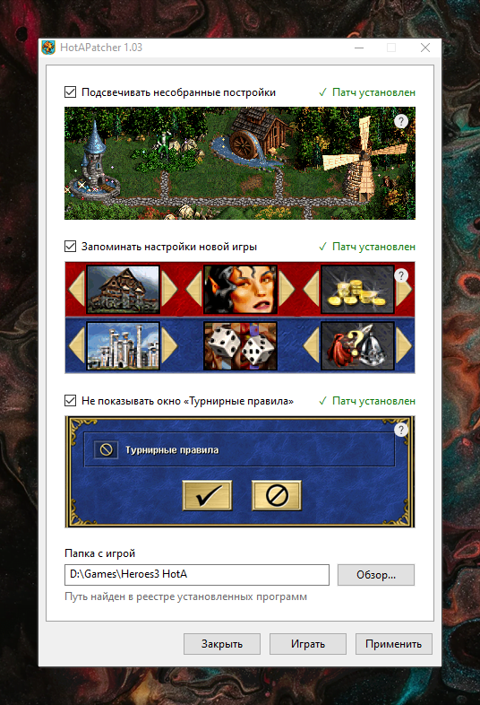

#  HotAPatcher

 

Утилита патчер для игры [Heroes 3: Horn of the Abyss](https://h3hota.com).

## Описание

**Подсвечивать несобранные постройки**. После патча ваши несобранные мельницы, водяные колёса, сады и склады будут мягко подсвечиваться искрами в цвет ресурса.

**Запоминать настройки новой игры**. При создании новой игры стартовые город, герой и бонус выставлены на случайные. Пропатченная игра подставляет выбор из прошлой сессии. Значение подставляется, только если оно доступно на выбранной карте. 

Выбор хранится в файле `HotA_Patcher.dat`, если его удалить, сохранение сбросится.

**Не показывать окно «Турнирные правила»**. При создании новой игры, окно появляется при каждом нажатии «Начать». Ни твики HD-мода, ни настройки игры его не отключают. Патч убирает этот лишний клик.

## Как пользоваться

1. Убедиться, что игра не запущена.
2. Запустить `HotAPatcher.exe`, желательно от имени администратора.
3. Путь к игре подставится автоматически, если она была установлена. Иначе указать папку вручную.
4. Отметить нужные галочки и нажать «Применить».
5. «Играть» закроют окно и запустит игру. 

Оригиналы перезаписываемых файлов сохраняются, отмена патча восстанавливает их.

## После обновления

Обновление HotA и HD-мода может перезаписать патченные файлы `HD_HOTA.dll`, `h3hota.exe` и `h3hota HD.exe`. В этом случае достаточно ещё раз запустить патчер.

Проверено на **HotA 1.8.1 + HD Mod 5.8**
